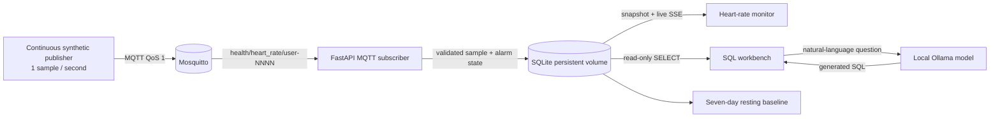

# Heart-Rate Monitor

A local demonstration of continuous synthetic heart-rate generation, MQTT streaming, durable history, configurable sustained high/low alerts, and descriptive personal baselines. It also retains a read-only SQL workbench and local natural-language query path.

> **Safety:** This is synthetic software, not a medical device or emergency monitor. Default alarm limits are illustrative settings, not medical recommendations. Personal baselines describe this generated profile; they are not an “optimal” range, diagnosis, or treatment advice.

## Architecture



Compose starts Mosquitto, the API, and a continuous heart-rate generator. The API subscribes to the broker and writes each validated sample to SQLite. The monitor streams updates to the browser with Server-Sent Events. Alert settings, readings, and alert/recovery events survive container restarts in the `heart_rate_data` volume. The broker uses persistent storage and MQTT QoS 1; the subscriber deduplicates messages by event ID.

Only heart-rate measurements are generated and stored. Each sample has an ID, synthetic profile ID, UTC timestamp, BPM, and a coarse activity label (`rest`, `active`, or `workout`). One profile streams by default; `SYNTHETIC_USER_ID` can change its ID. There is deliberately no step, sleep, workout-session, or weight stream.

### Why this stack

- **MQTT:** small, device-oriented publish/subscribe transport that fits a continuous wearable-style stream without introducing a larger event platform.
- **SQLite:** a durable local store is simple for one synthetic device at 1 Hz, supports the SQL workbench, and avoids operating a separate database service. It is not sized or configured as a multi-device production time-series platform.
- **Per-sample persistence:** incoming readings and alert transitions are committed immediately. A minute-level aggregate table makes the personal baseline inexpensive to recalculate without discarding raw readings.
- **Sustained alarms:** 15 consecutive readings must be strictly above the high limit or below the low limit before an alert triggers. A reading back in range resets the consecutive count; timestamp gaps do not, because the rule is based on received measurements rather than elapsed wall-clock time.
- **Local natural-language querying:** Ollama remains optional to the monitor’s readiness and runs locally. Generated SQL is constrained to one read-only query over `heart_rate`.

The MQTT broker is only reachable on Compose's private network. The API is published on host loopback (`127.0.0.1:8000`). The demo broker allows anonymous clients on that private network; do not expose the broker or API publicly.

## Run it

Prerequisites: Docker Engine and the Docker Compose plugin. On first startup, Ollama may download the configured model (`qwen2.5:3b`), which requires disk space, memory, CPU time, and internet access.

```sh
sudo docker compose up --build
```

- Live monitor: <http://localhost:8000/monitor>
- SQL workbench: <http://localhost:8000/>
- API docs: <http://localhost:8000/docs>

The monitor's default limits are low `<50 bpm`, high `>120 bpm`, with an alert after 15 consecutive out-of-range readings. Edit and save these values in the monitor; settings are stored per profile and persist across restarts. These are illustrative demo defaults only.

Useful environment overrides can be placed in `.env`:

```dotenv
ALARM_LOW_BPM=50
ALARM_HIGH_BPM=120
ALARM_AFTER_SAMPLES=15
SAMPLE_RATE_SECONDS=1
SYNTHETIC_USER_ID=user-0001
DATA_SEED=2025
OLLAMA_MODEL=qwen2.5:3b
```

The consecutive-reading threshold can be set from 1 to 300 samples and limits from 35 to 220 BPM, with low strictly below high. Stream cadence can be set from 0.1 to 2 seconds. Existing profiles keep their saved BPM limits; their old time-based alert duration is migrated to the configured default sample count on startup. A new `.env` default only initializes a profile's settings the first time that profile is created; afterward the saved settings take precedence. Existing values can be changed in the monitor.

`docker compose down` stops the system but keeps its volumes. `docker compose down -v` deletes the heart-rate history, MQTT persistence, and the downloaded Ollama model. The stream is continuous while Compose is running, so SQLite will grow over time; the demo intentionally does not silently expire saved readings.

## Monitor, history, and API

The monitor shows the latest sample, a rolling chart of the latest 60 readings (about one minute at the default sample rate), configured limits, and connection/staleness state. It raises a visual alert when the configured number of consecutive readings crosses a threshold. Trigger and recovery transitions are persisted and listed on the page.

The personal baseline uses the last seven days of resting samples, first averaging readings into one-minute buckets. It displays the average, median, and 5th–95th percentile range when there is data. The interface describes what this profile has recorded; it does not claim that range is medically optimal. A current resting sample outside that recent band is shown as a descriptive observation only.

Useful routes:

- `GET /api/monitor/users` — configured synthetic profiles.
- `GET /api/monitor?user_id=user-0001` — latest reading, recent samples, settings, alarm state/events, and baseline.
- `GET /api/monitor/stream?user_id=user-0001` — Server-Sent Events updates.
- `PUT /api/monitor/settings` — save `user_id`, `low_bpm`, `high_bpm`, and `alert_after_samples`.
- `GET /metrics/heart_rate` and `GET /metrics/summary` — bounded record and daily-summary APIs.
- `POST /api/query` — read-only SQL against the persisted `heart_rate` table.
- `POST /api/nl-query` — generate SQL with local Ollama, then validate and execute it through the same query guard.

The query workbench allows a single `SELECT` over `heart_rate` and caps results at 1,000 rows. It is a local synthetic-data tool, not an authenticated multi-user database.

## Tests

```sh
python -m pip install -r requirements-dev.txt
python -m pytest
```

Tests cover deterministic stream generation, persisted ingestion, alert timing and recovery, gap handling, personal-baseline aggregation, SQL validation, API behavior, and mocked local-model requests.

## AI usage and areas of depth

AI assistance was used for implementation drafting, test design, and architecture exploration. The system was redirected from a batch multi-metric pipeline to a heart-rate-only live stream. The implementation uses MQTT as the transport and SQLite as the local durable history rather than carrying forward the old MinIO/Parquet batch path. I would not trust AI alone to choose clinically appropriate alarm thresholds, validate physiological realism, or certify an emergency-monitoring product; those need qualified clinical input, device validation, and operational safety engineering.

The deeper parts are the sustained-alarm state machine (including gaps, recovery, and durable events) and the explicitly descriptive personal baseline over long-running persisted data.

If I had two more weeks, I would add a real device adapter behind the same MQTT event contract, evaluate storage/retention options under realistic long-duration load, and have qualified clinicians review alarm behavior and the presentation of personal baselines before making any claims beyond this synthetic demo.
