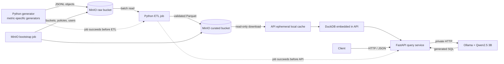

# AI-Queryable Health Data System

A local, end-to-end system that generates synthetic heart-rate, sleep, steps, workout, and weight data; lands and transforms it in object storage; and serves analytical queries over HTTP.

> **Status:** The data pipeline, API, local SQL workbench, and local natural-language query path are implemented. Automated Python tests cover generation, ETL, API routes, and query execution.

## Goals and scope

- One-command local startup with Docker Compose and no cloud account or paid API.
- Metric-specific synthetic data and schemas that preserve irregular sampling and missing observations.
- Separate generator, ETL, object-storage, and read-only query responsibilities.
- A local SQL workbench, validated HTTP query API (Bonus 1), and local natural-language query interface (Bonus 2).

This is a data engineering demonstration, not a medical product. All records and user IDs are synthetic; results are not medical advice or evidence of causal relationships.

## Architecture



Compose runs MinIO, a MinIO bootstrap helper, one-shot generator and ETL jobs, the API, and a private Ollama service plus one-shot model-download job. The model job downloads Qwen2.5 3B on first startup; the model is kept in its own named Docker volume. Compose builds MinIO Community and its `mc` client from pinned upstream source releases because the old published Community image tags used by the initial Compose file are no longer pullable from Docker Hub. The bootstrap helper creates the raw and curated buckets plus separate service users and least-privilege policies. Compose waits for the one-shot jobs to complete successfully before starting the API.

The generator writes JSON Lines objects to MinIO's raw bucket. ETL validates each record and writes metric-specific Parquet objects to the curated bucket. The API downloads curated objects using read-only credentials at startup, then DuckDB queries those local Parquet files. MinIO stores data on a Docker named volume, so it persists across container recreation without cloud services or a separately installed database.

MinIO demonstrates a real storage boundary, but a separate container is not inherently safer. Isolation comes from separate credentials and policies: the generator writes raw data, ETL reads raw and writes curated, and the API reads curated only. The batch jobs, MinIO, and Ollama share a private internal Compose network. Ollama also joins the bridge network for outbound model downloads, but its API is not published to the host. The API joins that bridge network so Docker can publish its HTTP port; the MinIO console is published only on host loopback (`127.0.0.1:9001`), and the API only on host loopback (`127.0.0.1:8000`). MinIO's object API is not published to the host. Compose uses local-demo credentials by default so a clean start needs no manual setup. These defaults are for synthetic data only—do not expose the stack publicly or use it for real health data.

To override the demo credentials, copy `.env.example` to `.env` and change the values before the first start. The example values are intentionally non-secret local defaults, not production credentials. If you change credentials after MinIO has already initialized its persistent volume, remove the volume with `docker compose down -v` before starting again so bootstrap can recreate the users.

## Data design

The deterministic default workload contains **100 synthetic users over 30 days**, using seed `2025`. A single Python generator has independent metric-specific logic; the different sampling patterns do not need separate generator containers or streaming systems.

| Metric | Shape and sampling | Curated fields |
|---|---|---|
| Heart rate | Five-minute samples while worn; one-minute workout samples; non-wear gaps; overnight patterns and workout recovery | `event_id`, `user_id`, `observed_at`, `bpm`, `activity` |
| Sleep | One overnight record per user/night, represented as contiguous stage intervals | `event_id`, `user_id`, `night_date`, `start_at`, `end_at`, `stage`, `duration_minutes` |
| Steps | Fifteen-minute daytime count buckets; zero counts retained while worn, non-wear periods omitted | `event_id`, `user_id`, `bucket_start`, `bucket_end`, `steps` |
| Workouts | Occasional session intervals, with activity type and intensity | `event_id`, `user_id`, `start_at`, `end_at`, `activity_type`, `intensity`, `avg_heart_rate` |
| Weight | Irregular weigh-ins, typically one to seven days apart; no fabricated interpolation | `event_id`, `user_id`, `measured_at`, `weight_kg` |

Users receive illustrative gradual-loss, stable, or mild-gain weight trajectories and varying activity profiles. Workouts correlate with elevated heart rate and steps by construction; trends can be compared across profiles, but the synthetic associations do not demonstrate that activity caused weight change. Data is plausible enough for exercising queries, not a validated physiological simulator or statistically representative cohort.

## Ingestion, storage, and query decisions

- **Batch, not streaming:** each metric has a different natural cadence, but this bounded workload is generated locally and ingested as a complete run. A message broker or per-source streaming deployment adds complexity without useful latency or cost benefits. Live wearable feeds could later stream independently into the same validated storage contract.
- **JSONL landing:** raw objects are inspectable and preserve each source's event shape.
- **Metric-specific Parquet:** ETL validates records and stores each metric separately, partitioned by its natural UTC event date. Parquet is compact and efficient for columnar analytical scans. Partitioning by user would create unnecessary small files at this scale. Invalid records fail ETL with the object key and line number rather than being silently dropped.
- **MinIO storage service:** local S3-compatible object storage makes the generator/ETL/query boundary explicit and can later be replaced by hosted object storage. Objects persist in a named Docker volume. No cloud account is required.
- **MinIO image availability:** MinIO Community no longer provides the old prebuilt Docker Hub images used by this project originally. The Compose build compiles pinned upstream MinIO and `mc` source releases locally. This avoids missing-image pulls and makes the source version explicit, at the cost of a longer first build and requiring internet access to pull Go/Alpine base images and Go modules. MinIO Community is AGPL-licensed; see the upstream [MinIO license](https://github.com/minio/minio/blob/master/LICENSE) and [mc license](https://github.com/minio/mc/blob/master/LICENSE). This local demo is not a supported production deployment.
- **DuckDB rather than PostgreSQL:** this workload is batch-generated, read-oriented analytics over Parquet. DuckDB runs in-process, scans Parquet directly, and avoids operating a database server and loading a second copy into tables. PostgreSQL would be preferable for frequent row updates, transactional workloads, or centralized concurrent application access; revisit that choice if those needs arise.
- **Python application stack:** generation, validation, ETL, object-store access, DuckDB queries, and FastAPI are implemented in Python. MinIO is the separate storage service.
- **API cache tradeoff:** Boto3 downloads the curated set to an ephemeral local directory when the API starts; DuckDB then reads local files. This avoids installing DuckDB's S3 extension at runtime and keeps query requests simple. Startup cost is proportional to the curated data size; direct S3 scans or an incremental cache would be more appropriate if the data grows substantially.

## Run locally

### Prerequisites

- Docker Engine (or Docker Desktop) with the Compose plugin.
- An available local port `8000` and enough disk for the Docker-managed MinIO volume.
- Internet access on the first run to pull container images, build the Python image, and download the local model (about 2 GB).
- Enough disk for the Docker images, generated dataset, and model; 8 GB of system memory is recommended for comfortable CPU inference.

### Start

```sh
docker compose up
```

On a clean machine, Compose builds the Python and MinIO images, starts MinIO and Ollama, initializes buckets and service credentials, generates raw data, runs ETL, downloads Qwen2.5 3B, then starts the API. First startup also downloads the model and can take several minutes; later starts reuse it. No `.env` file, manual model setup, cloud account, paid API, or separate database installation is required. The API is at `http://localhost:8000`, and the MinIO console is at `http://localhost:9001`, both bound to host loopback. Use `docker compose up --build` to force a rebuild after changing application code or dependencies.

The MinIO console uses the root credentials `healthdata-admin` / `local-minio-root-password` by default. If configured in `.env`, use the `MINIO_ROOT_USER` and `MINIO_ROOT_PASSWORD` values instead.

The named MinIO volume preserves data when containers are recreated, and a separate Ollama volume preserves the downloaded model. The generator and ETL jobs write completion markers; when Compose reruns these one-shot containers after a restart, they detect a matching complete dataset and reuse it rather than regenerating or retransferring it. The bootstrap job reapplies the service policies on startup so policy changes are reflected in existing MinIO volumes. If generation is interrupted before its marker is written, the next run safely rewrites the same deterministic object keys and finishes the dataset.

To intentionally delete all raw and curated data and start over:

```sh
docker compose down -v
docker compose up --build
```

Do not run `down -v` if you want to retain generated data.
If you change `DATA_SEED` or the generator's dataset layout, reset the volume before regenerating; object keys are stable across runs of the same configuration.
Adding the local model does not require deleting existing data volumes. Rebuild and start the updated services with `docker compose up --build`.

### Bonus 1: HTTP query API

The parameterized metric endpoints use structured filters, while the workbench accepts a restricted, read-only SQL `SELECT` over the five curated tables.

Dates are UTC calendar dates, and `end_date` is inclusive. Identifiers must match `user-NNNN`.

```sh
curl http://localhost:8000/health
curl 'http://localhost:8000/metrics/heart_rate?user_id=user-0001&start_date=2025-01-01&end_date=2025-01-02&limit=100'
curl 'http://localhost:8000/metrics/summary?user_id=user-0001&metrics=weight,steps,workouts&start_date=2025-01-01&end_date=2025-01-30'
```

- `GET /health` reports service liveness.
- `GET /metrics/{metric}` returns records for `heart_rate`, `sleep`, `steps`, `workouts`, or `weight`. Results are bounded (`limit` 1–1,000).
- `GET /metrics/summary` returns daily summaries for a comma-separated metric list; it defaults to all five. Weight appears only on measurement days, and absent observations are not interpolated.

Both routes return a JSON object echoing the selected metric(s), user, date range, and results. The summary response also declares its daily grain. For example, a summary response has this shape:

```json
{
  "user_id": "user-0001",
  "start_date": "2025-01-01",
  "end_date": "2025-01-07",
  "metrics": ["heart_rate", "steps"],
  "grain": "day",
  "results": [
    {
      "date": "2025-01-01",
      "heart_rate": {
        "average_bpm": 65.2,
        "min_bpm": 51,
        "max_bpm": 92,
        "observations": 270
      },
      "steps": {
        "total_steps": 8612,
        "buckets": 64
      }
    }
  ]
}
```

The API validates metric names, user IDs, date ordering, date-range bounds, and result limits. Invalid parameters return HTTP `422`; unsupported metric names on the records route return `404`. Unexpected storage or query failures are not disguised as successful responses. On startup, failure to download curated data prevents the API from becoming ready.

### Local SQL workbench

Open `http://localhost:8000` to use the browser-based workbench. The left catalog lists available tables and Parquet file counts. Right-click a table to preview rows, inspect its schema, or add a starter `SELECT` to the editor. Ask a plain-language question in the natural-language panel; the generated SQL appears in the editor and results appear below. Run a query with the button or `Ctrl+Enter`; results appear in a scrollable grid. The editor includes sample queries, including an example that joins steps and workouts.

The workbench submits SQL to `POST /api/query` as JSON (`{"sql":"SELECT ... FROM heart_rate"}`) and returns the selected columns, rows, row count, and whether results were truncated. `GET /api/catalog`, `/api/catalog/{table}/schema`, and `/api/catalog/{table}/preview` support the catalog actions. Queries are capped at 1,000 returned rows and 20,000 characters.

For safety, only one `SELECT` statement is accepted. It can read only the known curated tables (`heart_rate`, `sleep`, `steps`, `workouts`, `weight`); table functions, external file reads, non-allowlisted functions, DDL, and DML are rejected. SQL parse/validation and execution errors return HTTP `400` with a clear detail. Structured endpoint validation errors remain HTTP `422`. This is a local synthetic-data workbench, not an authenticated public SQL service.

OpenAPI/Swagger documentation is available at `http://localhost:8000/docs`.

### Bonus 2: local natural-language query

`POST /api/nl-query` accepts `{"question":"What was user-0001's average resting heart rate last week?"}` and returns the question, model name, generated SQL, columns, rows, row count, and truncation status. Relative dates are interpreted against the latest date in the loaded dataset. The API sends the question and table schema to the local Ollama service, then submits the generated SQL through the same SQL parser, allowlist, and 1,000-row cap as manual queries. Model unavailability returns HTTP `503`; malformed model output or SQL rejected by validation returns HTTP `502`. A successful response is not a guarantee that the question was interpreted correctly: inspect the SQL and results.

```sh
curl -X POST http://localhost:8000/api/nl-query \
  -H 'Content-Type: application/json' \
  -d '{"question":"What was user-0001 average resting heart rate last week?"}'
```

The default model is `qwen2.5:3b`, configured through `OLLAMA_MODEL` in `.env` or the environment. It runs locally on CPU without an API key, account, or per-request fee. Model weights require an initial download (about 2 GB), disk space, memory, and CPU time; response latency depends on the machine. Ollama has no published host port; the API reaches it over the Compose network. Qwen2.5 is published under Apache-2.0 terms; see the upstream [Qwen2.5 license](https://github.com/QwenLM/Qwen2.5/blob/main/LICENSE) and [Ollama model page](https://ollama.com/library/qwen2.5). Verify applicable license terms before redistribution or commercial use.

### Tests

```sh
python -m pip install -r requirements-dev.txt
python -m pytest
```

Tests cover deterministic generation, distinct metric shapes, completion-marker reuse on restart, ETL validation, DuckDB record and cross-metric summary queries, and mocked local-model request/response behavior. The full Compose path and the example requests should additionally be smoke-tested on a machine with Docker installed.

## Areas of depth

1. **Metric-aware data modeling:** points, intervals, count buckets, and sparse measurements remain distinct; cross-metric summaries align by day without inventing missing measurements.
2. **Reproducible, bounded ingestion:** a fixed seed, visible JSONL-to-Parquet stages, validation, date partitioning, and least-privilege service identities make the pipeline inspectable.

## AI usage

AI assistance was used for architecture exploration and implementation drafting. The initial single-metric proposal was broadened to all five metrics with different sampling shapes. The first local-files-only storage suggestion was changed to MinIO after discussing the value of demonstrating a service boundary. The implementation separates generator, ETL, storage, and API responsibilities while retaining batch ingestion for the small synthetic workload.

I would not trust AI alone to establish that synthetic health data is physiologically valid, generated SQL answers the question, query results are correct, or deployment is secure. Those require explicit assumptions, tests against known data, and human review. The API's ephemeral cache instead of direct DuckDB-to-S3 querying is a deliberate tradeoff to avoid a runtime extension dependency; it should be revisited if data size grows.

If I had two more weeks, I would add a user-facing query history with saved, human-reviewed examples; benchmark and tune the local model against a fixed set of natural-language questions; and add explicit semantic checks for date ranges and aggregation intent. I would also load-test concurrent queries and decide whether the API's startup cache should become incremental as the dataset grows.
